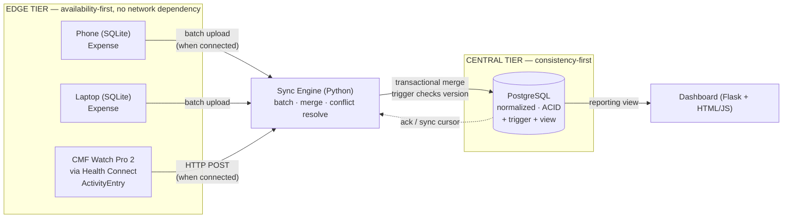

# PROJECT PLAN
## EdgeDB — An Offline-First Expense & Activity Tracker with Conflict-Resilient Synchronization

**Course:** Database Management Systems
**Student:** Vichruth M (24BCE2300)
**Programme:** B.Tech Computer Science and Engineering, VIT Vellore
**Plan version:** 2.0 · **Prepared:** 07 Sep 2026

**Companion documents**
- [projectworkflow.md](projectworkflow.md) — project initialization report (problem statement, motivation, faculty-facing framing, demo script)
- [PHASE_WISE_PLAN.md](PHASE_WISE_PLAN.md) — day-level task breakdown, per-phase exit gates, cut-lines

> This document is the **master plan**: what is being built, how it is architected, what gets delivered, how it is measured, and what can go wrong. It deliberately does *not* repeat the day-by-day task list — that lives in the phase-wise plan.

---

## 1. One-paragraph summary

EdgeDB is a two-tier database system in which multiple independent devices — a simulated phone, a simulated laptop, and the author's own **CMF Watch Pro 2** (via Google Health Connect) — write data **fully offline** and reconcile with a central PostgreSQL store only when connectivity returns. The phone and laptop generate `Expense` records (with an on-device ML classifier assigning a category); the watch generates `ActivityEntry` records (step counts). A Python sync engine batches each device's unsynced records and merges them into the normalized central schema inside a single transaction. The project's centerpiece is the deliberate **reproduction of a lost update** when two sources sync conflicting data concurrently, followed by a fix enforced as a **PostgreSQL trigger** (optimistic versioning) — compared against pessimistic row locking — that detects, resolves, and logs the conflict. Indexing benchmarks and a reporting **view** round out the DBMS-native mechanisms on display. A minimal dashboard surfaces expenses, activity, and the conflict log.

---

## 2. Objectives → deliverable mapping

| # | Objective | Deliverable artifact | Verifiable how |
|---|---|---|---|
| O1 | Normalized central schema + lightweight local schema + EER device specialization | `sql/central_schema.sql`, `sql/local_schema.sql`, ER + EER diagrams | Schema loads clean; FD walkthrough proves BCNF |
| O2 | Offline-first local storage buffering writes independent of network | `src/local_store.py`, `src/device_sim.py`, watch Android client | Devices/watch run to completion with Postgres stopped |
| O3 | Atomic batch merge into central store | `src/sync_engine.py` | Forced mid-batch failure → row count unchanged |
| O4 | Reproduce **then** resolve the lost-update conflict, enforced via a DB trigger | `sql/triggers.sql`, `experiments/exp_conflict_race.py` + before/after logs | Run A shows lost update; Run B shows `conflict_log` row written by the trigger |
| O5 | Indexing + a reporting view improve/simplify queries measurably | `sql/indexes.sql`, `sql/views.sql`, `experiments/exp_indexing.py`, results table | `EXPLAIN ANALYZE` before/after with real timings |
| O6 | On-device ML classifier feeding a real column/query/index | `src/classifier.py` | Category column populated, used in a report query and an index |
| O7 | Real watch integration via Health Connect | `watch-client/` (Android), `experiments/exp_watch_sync.py` | Live `ActivityEntry` rows traceable to the physical watch |
| O8 | Minimal dashboard surfacing expenses, activity, sync status, conflicts | `dashboard/index.html`, `src/api.py` | Manual walkthrough against a running backend |
| O9 | Contemporary issues: offline-sync precedents + activity/financial data privacy | `docs/final-report.md` §Contemporary Issues | Written section, cited (discussion-only by design) |

---

## 3. Architecture



### Tier responsibilities

| Tier | Owns | Optimized for | Never does |
|---|---|---|---|
| Edge (SQLite, phone/laptop) | Local event log, sync cursor | Fast local writes, zero-config, works fully offline | Block on network; validate against central state |
| Edge (Watch, via Health Connect) | Local step counts on-device | Zero app-side storage burden — relies on Health Connect as the local buffer | Talk to the central store directly (goes through the Android client → sync engine) |
| Sync engine (Python) | Batching, ordering, HTTP intake from the watch client, acks | Atomicity per batch, idempotent retry | Silently drop or overwrite a conflicting write |
| Central relational (PostgreSQL) | Canonical merged records, conflict audit trail, trigger-enforced conflict detection, reporting view | ACID correctness, indexed sync/report queries | Accept a partial batch; accept a stale write past its expected version |

### Key design decisions (and the alternative rejected)

| Decision | Chosen | Alternative considered | Why |
|---|---|---|---|
| Local store (phone/laptop) | SQLite, one file per device | Shared local Postgres | Per-file isolation genuinely models independent devices; SQLite is what real constrained devices ship |
| Watch data path | Google Health Connect → small Android client → HTTP POST to sync engine | Direct BLE to the watch | CMF Watch Pro 2 has no documented public API; Health Connect is the officially supported sync path |
| Batch identity | Client-generated `(device_uuid, client_batch_seq)` | Server-assigned only | Makes retries idempotent — a re-sent batch is detectable, not duplicated |
| Conflict strategy | **Optimistic versioning enforced by a `BEFORE UPDATE` trigger** on `expense`/`activity_entry`, with pessimistic `SELECT ... FOR UPDATE` implemented as a compared alternative | Pure LWW on timestamp; conflict check only in application code | A trigger enforces the rule regardless of which client wrote the SQL — a stronger correctness guarantee, and a genuine DBMS mechanism, not just Python logic. Pure LWW hides the conflict instead of surfacing it |
| Reporting access | A `category_totals` / `activity_daily` **view**, queried by the dashboard | Raw ad-hoc SQL per dashboard request | Demonstrates views as a reusable abstraction; one definition, reused by dashboard and report generation |
| Clock trust | Device timestamps treated as **untrusted**; central `received_at` recorded separately | Trust device clocks | No shared clock across offline devices — honest modelling of the problem |

---

## 4. Data model plan

### 4.1 Entities and cardinalities

- `Device` (supertype) **ISA** `PhoneDevice` / `LaptopDevice` / `WatchDevice` — disjoint, total specialization
- `Device` **1 — N** `Expense` (phone/laptop only, in practice)
- `Device` **1 — N** `ActivityEntry` (watch only, in practice)
- `Device` **1 — N** `SyncBatch`
- `Category` **1 — N** `Expense`
- `SyncBatch` **1 — N** `Expense`, `SyncBatch` **1 — N** `ActivityEntry`
- `SyncBatch` **1 — 0..N** `ConflictLog`
- `Expense` **1 — 0..N** `ConflictLog`, `ActivityEntry` **1 — 0..N** `ConflictLog`

### 4.2 Central schema (PostgreSQL) — target shape

| Table | Key columns | Purpose |
|---|---|---|
| `device` | `device_id` PK, `device_uuid` UQ, `device_name`, `device_type` | Registered devices (supertype row) |
| `phone_device` / `laptop_device` / `watch_device` | `device_id` PK/FK → `device` | EER specialization, table-per-subtype, subtype-specific columns (`imei`, `mac_address`, `watch_model`) |
| `category` | `category_id` PK, `category_name` UQ | Lookup table, removes free-text category from `expense` |
| `expense` | `expense_id` PK, `device_id` FK, `category_id` FK, `amount`, `description`, `confidence`, `event_time`, `version`, `updated_at` | Canonical merged expense — the row conflicts fight over |
| `activity_entry` | `activity_id` PK, `device_id` FK, `entry_date`, `step_count`, `version`, `updated_at` | Canonical merged step count per device per day |
| `sync_batch` | `batch_id` PK, `device_id` FK, `client_batch_seq`, UQ`(device_id, client_batch_seq)`, `received_at`, `record_count`, `status` | Unit of atomicity; idempotency key |
| `conflict_log` | `conflict_id` PK, `expense_id` FK NULL, `activity_id` FK NULL, `batch_id` FK, `existing_value`, `incoming_value`, `existing_ts`, `incoming_ts`, `strategy`, `resolved_at` | Audit trail; the evidence artifact for O4, populated by the trigger |

### 4.3 Local schema (SQLite, phone/laptop) — deliberately flat

| Table | Columns | Note |
|---|---|---|
| `local_expense` | `local_id` INTEGER PK AUTOINCREMENT, `amount`, `description`, `category`, `confidence`, `event_time`, `synced` (0/1), `sent_in_batch` | Append-only hot path; flat on purpose |
| `device_meta` | `key`, `value` | `device_uuid`, `next_batch_seq`, `last_sync_at` |

> The watch has no local schema of its own — Health Connect *is* its local buffer, which is itself a report-worthy point: not every edge device needs its own bespoke local store if a trustworthy OS-level one already exists.

### 4.4 Normalization walkthrough (to be written out in the report)

Show, per central table: attribute set → functional dependencies → candidate key(s) → why every non-trivial FD has a superkey on the left (BCNF). Include one deliberately wide pre-normalization table (e.g. a `device_reading` table mixing device attributes with expense/activity readings) and decompose it 1NF → 2NF → 3NF → BCNF, naming the violating FD removed at each step.

---

## 5. Experiment plan (where the marks are)

### E1 — Offline-first proof
Stop PostgreSQL. Run phone/laptop simulators and capture watch data via the Android client (or a saved Health Connect export if live capture isn't possible at test time). **Pass criterion:** zero errors, all events present locally / in Health Connect, nothing in the central DB. Then start the central tier and sync — every buffered record lands exactly once.

### E2 — Atomicity of batch merge
Inject a failure mid-batch. **Pass criterion:** `expense`/`activity_entry` and `sync_batch` counts identical to pre-run values; local events remain unsynced and are re-syncable.

### E3 — Conflict reproduction → resolution *(centerpiece)*

| Run | Concurrency control | Expected observable |
|---|---|---|
| A | none (naive read-modify-write, no version check, trigger disabled) | **Lost update** — one write silently overwritten; `conflict_log` empty |
| B | optimistic versioning, enforced by a `BEFORE UPDATE` PL/pgSQL trigger (`WHERE version = :expected`) | Update rejected/redirected → conflict detected → trigger inserts a `conflict_log` row automatically |
| C | pessimistic (`SELECT … FOR UPDATE`) | Second transaction serializes behind the first; no lost update; timing shows the wait |

Run this for both an `expense` collision (phone vs. laptop editing the same expense) and an `activity_entry` collision (watch vs. a second reading source, or two overlapping watch syncs), to demonstrate the mechanism generalizes across data types.

### E4 — Indexing + view benchmark

Scale to realistic size (thousands of `expense` and `activity_entry` rows) before measuring.

| ID | Query | Index added |
|---|---|---|
| Q1 | Unsynced/latest records for one device | `expense(device_id, event_time DESC)` |
| Q2 | Total spent per category (via `category_totals` view) | `expense(category_id)` |
| Q3 | Steps per day for one device (via `activity_daily` view) | `activity_entry(device_id, entry_date)` |
| Q4 | Conflicts per device (join + aggregate) | `conflict_log(expense_id)`, `conflict_log(activity_id)` |

Results table template (real numbers, median of ≥5 runs, cache state stated):

| Query | Plan before | Time before (ms) | Plan after | Time after (ms) | Speedup |
|---|---|---|---|---|---|
| Q1 | Seq Scan | | Index Scan | | |
| Q2 | | | | | |
| Q3 | | | | | |
| Q4 | | | | | |

Record one honest negative/neutral result if one appears, and explain why.

### E5 — Real watch integration
Read live step data from the CMF Watch Pro 2 via Health Connect through the Android client, POST it into the sync pipeline, and show it landing in `activity_entry` and rendering on the dashboard. This is the one experiment that cannot be faked with a simulator — it is the strongest "this is real, not just simulated" evidence in the project.

---

## 6. Technology stack

| Layer | Technology | Version target | Justification |
|---|---|---|---|
| Edge/local storage | SQLite | 3.x (stdlib `sqlite3`) | Zero-config, single file, realistic for constrained offline devices |
| Central relational | PostgreSQL | 15+ | Full ACID, `EXPLAIN ANALYZE`, row-level locking, PL/pgSQL triggers/views |
| Watch integration | Google Health Connect API (Kotlin/Android) | — | Documented, officially supported sync path for CMF Watch Pro 2 step data |
| Simulation / sync / harness | Python | 3.11+ | `psycopg[binary]`, `sqlite3`, `concurrent.futures`, `Flask` |
| ML classifier | scikit-learn (logistic regression / naive Bayes) | — | Small, fast enough per-write on a constrained device |
| Dashboard | Flask backend + plain HTML/JS | — | Minimal surface for expenses, activity, conflicts; no build step |
| Diagrams | Mermaid | — | ER/EER diagrams exportable as images for the report |

Local runtime assumption: PostgreSQL on localhost (native or Docker — note which in the report). No cloud dependency for the core pipeline; Health Connect is the one external, but standard and documented, dependency.

---

## 7. Repository layout (target)

```
dbms class project/
├── PROJECT_PLAN.md            ← this file
├── PHASE_WISE_PLAN.md
├── projectworkflow.md
├── requirements.txt
├── docs/
│   ├── er-diagram.mmd / .png
│   ├── eer-diagram.mmd / .png
│   ├── normalization.md
│   ├── syllabus-mapping.md
│   └── final-report.md
├── sql/
│   ├── central_schema.sql
│   ├── local_schema.sql
│   ├── triggers.sql
│   ├── views.sql
│   ├── indexes.sql
│   └── queries/q1.sql … q4.sql
├── src/
│   ├── config.py
│   ├── local_store.py
│   ├── device_sim.py
│   ├── central_store.py
│   ├── classifier.py
│   ├── sync_engine.py
│   └── api.py
├── watch-client/               ← minimal Android app (Health Connect → HTTP POST)
├── dashboard/
│   └── index.html
├── experiments/
│   ├── exp_offline.py
│   ├── exp_atomicity.py
│   ├── exp_conflict_race.py
│   ├── exp_indexing.py
│   ├── exp_watch_sync.py
│   └── results/            ← logs, EXPLAIN output, screenshots
└── data/                   ← per-device .sqlite files (not committed)
```

---

## 8. Milestones

| ID | Milestone | Done means |
|---|---|---|
| M0 | Design frozen | ER + EER diagrams + both schemas + normalization walkthrough drafted; conflict strategy (trigger-based) chosen |
| M1 | Edge tier working offline | E1 passes with central tier fully stopped |
| M2 | Central tier + transactional sync | E2 passes; batch merge is all-or-nothing |
| M3 | Conflict before/after captured | E3 runs A, B, C captured with logs, trigger verified writing `conflict_log` |
| M4 | Indexing + views captured | E4 table filled with measured timings; `views.sql` in use by the dashboard |
| M5 | Watch integration live | E5 passes — real step data visible end-to-end from the physical watch |
| M6 | Dashboard + final report submitted | Report complete incl. syllabus mapping; repo reproducible from clean clone |

---

## 9. Effort allocation

| Area | Share of effort | Rationale |
|---|---|---|
| Design: ER/EER, normalization, FD walkthrough | 20% | Directly graded, everything downstream depends on it |
| Conflict reproduction + resolution (trigger) | 25% | The centerpiece and the strongest demonstrable artifact |
| Indexing + views + query optimization | 15% | Hard evidence with real numbers; showcases DBMS-native mechanisms |
| Sync engine + transactional merge | 15% | Enables the two items above |
| Edge layer + simulators | 8% | Straightforward once the local schema is fixed |
| Watch integration (Health Connect) | 7% | Real-hardware differentiator; scoped small deliberately |
| ML classifier | 5% | Small, load-bearing, not decorative |
| Dashboard | 5% | Makes the conflict/sync story visible |
| Report writing + syllabus mapping | (folded into each phase's fragment) | The evaluator reads this, not the code |

---

## 10. Risk register

| # | Risk | Likelihood | Impact | Mitigation | Trigger to act |
|---|---|---|---|---|---|
| R1 | Lost update won't reproduce (races too fast/rare) | Medium | High — it's the centerpiece | Explicit synchronization barrier; deliberate delay between read and write to widen the window | No lost update after 20 attempts |
| R2 | Indexing shows no improvement | Medium | Medium | Scale data to realistic size before measuring; `ANALYZE` first; report an honest neutral result if that's the truth | Speedup < 1.5× at target scale |
| R3 | Watch/Health Connect integration eats time or doesn't work reliably | Medium | Medium | Time-box to 2 days; fallback is a captured Health Connect **export** (CSV/JSON) fed into the pipeline manually, presented honestly as "real data, semi-manual sync" | Not working by end of Phase 5 day 1 |
| R4 | Scope creep into a polished frontend | Medium | Medium | Scope frozen — dashboard stays a single plain page | Any time spent on frontend polish |
| R5 | Report left to the last day | Medium | High | Write each phase's report fragment *inside* that phase | Any phase closed without its fragment |
| R6 | Trigger logic has an edge case (e.g. doesn't fire on the intended path) | Low | High | Unit-test the trigger directly with raw SQL before wiring the sync engine to it | Trigger not verified independently by end of Phase 3 day 2 |
| R7 | Environment loss (DB wiped, laptop reset) | Low | High | All schema/data generation scripted and idempotent; results committed as text | — |

---

## 11. Scope control

**In scope (frozen):** phone + laptop simulators; one real watch (CMF Watch Pro 2) via Health Connect; normalized central PostgreSQL schema with EER device specialization; transactional batch sync/merge engine; trigger-enforced conflict detection and audit logging; a reporting view; indexing experiments with measured results; a small on-device ML classifier; a minimal single-page dashboard; final report.

**Out of scope (frozen — do not reopen without cutting something else):** direct Bluetooth/BLE access to the watch; any production-grade UI framework; production auth/encryption/security hardening (discussion only); multi-user accounts; NoSQL/MongoDB component; CAP-theorem essay; horizontal scaling, sharding, or replication.

---

## 12. Syllabus coverage mapping

| Course topic | Where demonstrated |
|---|---|
| ER/EER modelling, cardinality, specialization | ER + EER diagrams; §4.1 |
| Relational model & constraints | `central_schema.sql` (PK/FK/UNIQUE/CHECK) |
| SQL: DDL, DML, joins, aggregation | Schema scripts; `sql/queries/` (Q1–Q4) |
| Normalization (1NF→BCNF), FDs | `docs/normalization.md` — full decomposition walkthrough |
| Transactions & ACID | E2 atomicity demo (forced mid-batch rollback) |
| Concurrency control, lost update, isolation levels | E3 runs A/B/C — the centerpiece |
| Triggers | `sql/triggers.sql` — conflict detection enforced in the database |
| Views | `sql/views.sql` — `category_totals`, `activity_daily`, used by the dashboard |
| Locking (pessimistic) vs. versioning (optimistic) | E3 run C vs. run B; comparison in report |
| Indexing, query plans, optimization | E4 with `EXPLAIN ANALYZE` before/after |
| Contemporary issues, data privacy | Report §Contemporary Issues (offline-sync precedents, financial + health data privacy) |

Any topic left uncovered after M5 gets a short dedicated section rather than being quietly omitted.

---

## 13. Definition of done

1. A clean clone plus `requirements.txt` and the SQL scripts reproduces every result end to end via documented commands.
2. E1–E5 all executed, with raw outputs stored under `experiments/results/`.
3. The conflict before/after (E3) is captured as concrete evidence — logs and table contents, not prose claims — with the trigger independently verified.
4. The indexing table (E4) contains real measured timings with the data scale and cache state stated.
5. `docs/normalization.md` contains the full FD-to-BCNF walkthrough for every central table.
6. Real step data from the CMF Watch Pro 2 is visible end-to-end at least once (E5), or the honest fallback (Health Connect export) is documented as such.
7. `docs/final-report.md` covers all nine objectives, includes the syllabus mapping table, and names its limitations honestly.
8. Out-of-scope items are stated as deliberate exclusions in the report, not left as apparent gaps.

---

*Plan version 2.0 supersedes the earlier EdgeSync (IoT fleet + MongoDB + CAP) draft. The pivot rationale: the concurrency-control core stays identical in depth; the domain (expense + activity tracking) is more relatable and demoable, and the addition of a real owned device (the watch) provides stronger differentiation than a purely simulated device fleet.*
