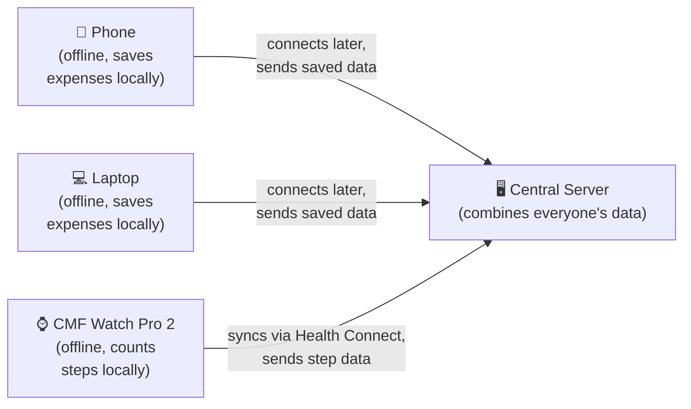
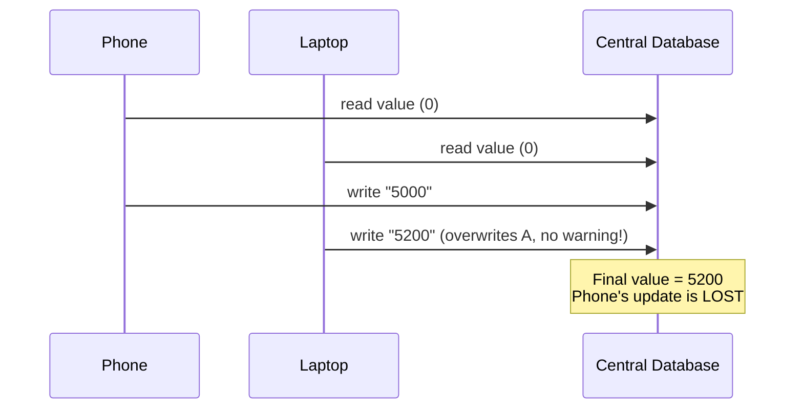
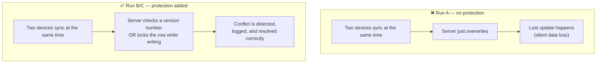
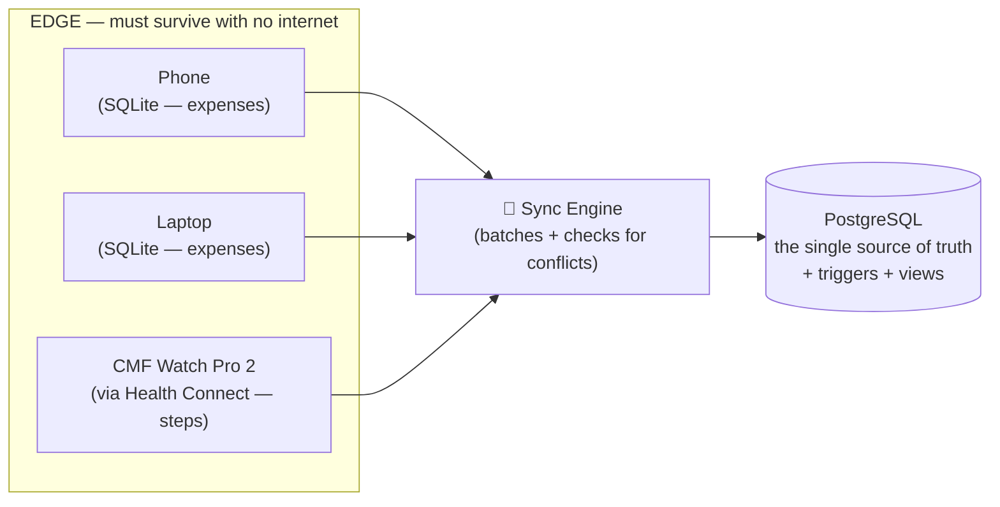

# EdgeDB — Explained Simply

## The everyday analogy

Think of a **fitness tracker** (like a Fitbit, or your own smartwatch).

- It counts your steps **all day, even with zero internet** — in a basement, on a flight, anywhere.
- It just saves the numbers to its own tiny internal memory and keeps going.
- Later, when it finds wifi, it sends everything it saved to the central app/server, which merges it into your permanent history.

This project models exactly that shape — except there are **two kinds of data** (expenses and activity/steps) coming from **multiple independent devices** (a phone, a laptop, and — for the real demo — an actual smartwatch), and the central database has to reconcile all of it correctly.

---

## The real problem: what happens when two devices collide

Imagine you edit **the same expense** on your phone and your laptop, both offline.

- Phone comes online first and says: *"this expense = 5000"*
- Laptop comes online a split-second later and says: *"this expense = 5200"*

If the server isn't careful, whichever one arrives **last just overwrites the other** — the phone's edit quietly vanishes. Nobody gets an error. It just silently disappears.

This is a textbook database bug called a **lost update**. The same thing can happen with step counts: your watch says 8,000 steps for today, your phone's own pedometer says 8,200 for the same day — two independent sources, one truth, and a naive server picks one and throws the other away.

---

## What this project actually does

**It deliberately causes this exact bug — then fixes it — and proves both with real logs.**

| | Before (Run A) | After (Run B & C) |
|---|---|---|
| What happens | One update silently overwrites the other | Server detects the collision |
| Evidence | `conflict_log` table is **empty** — bug is invisible | `conflict_log` table has a **row** proving it caught the conflict |
| Fix technique | none | "check before overwrite" (versioning, enforced by a DB trigger) **or** "lock while writing" (row locking) |

This before/after comparison — proven with actual database logs, not just claims — is the centerpiece of the whole project.

---

## The architecture

Two device *kinds* (Phone/Laptop typed as `Device`, generating `Expense` rows; the Watch also typed as a `Device` subtype, generating `ActivityEntry` rows) flow through the **same** sync engine and the **same** conflict-detection mechanism — proving the mechanism generalizes, not just working for one hardcoded data type.

---

## What's actually built (deliverables, not theory)

1. **A schema design** — normalized central schema (PostgreSQL) + flat local schema (SQLite), with EER specialization for device types (Phone/Laptop/Watch).
2. **Working code** — device simulators (phone/laptop) + a real Android/Health-Connect client for the watch + a sync engine that merges everyone's data.
3. **The conflict demo** — reproducing the lost update, then fixing it (via optimistic versioning enforced by a Postgres trigger, and compared against row locking), with logs as proof.
4. **A speed benchmark** — showing that adding an index makes searching the database measurably faster (with real before/after `EXPLAIN ANALYZE` timings).
5. **DBMS-native mechanisms** — a trigger for conflict detection, a view for reporting queries — not just application-level Python logic.
6. **A minimal dashboard** — expense feed, totals-by-category, activity feed, and a conflict-log panel showing a resolved conflict before/after.
7. **A final report** — tying it all together with the reasoning behind each decision.

---

## How to say it in one breath

> "Most database projects have one client always connected to one server. Mine has multiple independent devices — including my own smartwatch — that work completely offline and only occasionally sync, across two different kinds of data. The real challenge is what happens when two of them try to update the same thing at once. I show the bug happening, fix it using real database mechanisms like triggers and versioning, and prove both with logs."
